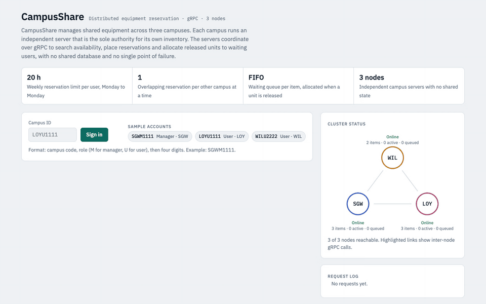
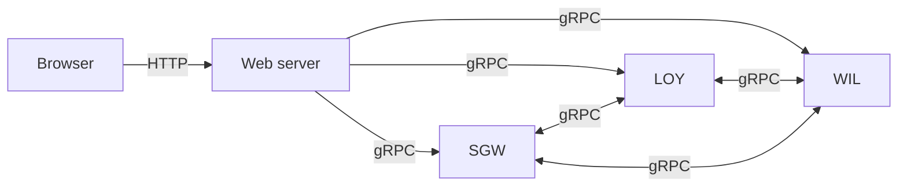
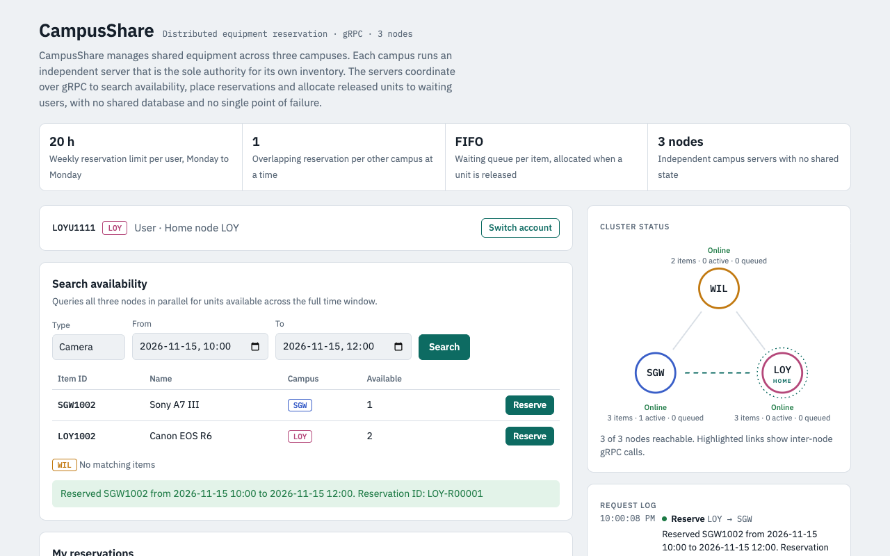
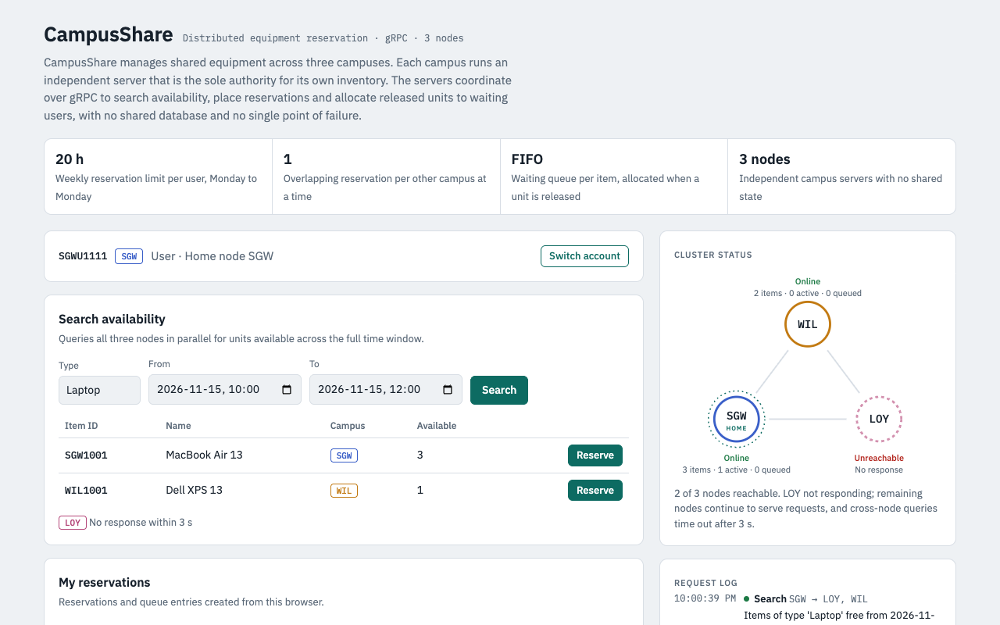

# CampusShare

An equipment reservation system for three university campuses, built in Java with gRPC.

Each campus (SGW, LOY and WIL) runs its own server and keeps track of its own equipment, like laptops, cameras and projectors. There's no shared database. When a student reserves something from another campus, their home server calls that campus's server over gRPC. If one campus goes down, the other two keep working.

I built this to learn how distributed systems handle calls between servers, timeouts and multiple requests hitting the same item at once.

## Demo



[Full video (mp4)](docs/demo.mp4)

In the demo, a LOY student reserves an SGW camera, a WIL student joins the waiting queue for it, the LOY student cancels, and the camera goes to the WIL student automatically. Then the LOY server is shut down and searches still work on the other two campuses.

## Features

- Three independent campus servers that talk to each other over gRPC
- Search all campuses at once, with a 3 second timeout per campus
- Waiting queue for full items, first come first served
- Reservation rules: max 20 hours per week, max one overlapping reservation at each other campus
- Web page that shows which servers are up and which calls each request makes

## How it works



Every ID starts with its campus (`LOYU1111` is a LOY user, `SGW1002` is an SGW item). A request goes to the user's home campus, which checks the user's rules and then calls the campus that owns the item. The web server is only there because browsers can't call gRPC directly.

More detail in the [design notes](docs/DESIGN.md).

## Running it

Needs Java 21+.

```bash
./run.sh
```

This starts the three campus servers and the web server with some sample equipment. Open http://localhost:8080 and sign in with one of these:

| ID | Role |
|---|---|
| `SGWM1111` | manager at SGW |
| `LOYU1111` | user at LOY |
| `WILU2222` | user at WIL |

To start the servers one at a time (for example to stop one and see what happens):

```bash
./gradlew installDist
build/install/drms/bin/drms-server SGW   # run SGW, LOY and WIL in separate terminals
build/install/drms/bin/drms-web
```

## Tests

```bash
./gradlew test
```

The unit tests cover ID checks, reserving and cancelling, full items, the weekly limit, the waiting queue and failed updates. I tested the cross-campus parts by hand with all three servers running.

## Screenshots





## Limitations

- Data is stored in memory, so restarting a server clears it.
- No real login, and gRPC traffic isn't encrypted.
- Requests that fail because a campus is down aren't retried.

## Tech

Java 21, gRPC, Protocol Buffers, Gradle, JUnit 5, HTML/CSS/JS
