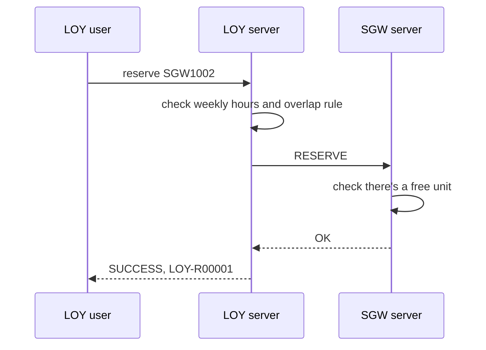

# Design notes

Some notes on how CampusShare works and why I set it up this way.

## Who owns what

Every ID starts with its campus, so any server can tell where something lives without asking anyone:

| Kind | Example |
|---|---|
| Manager | `SGWM1111` |
| User | `LOYU1111` |
| Item | `SGW1002` |
| Reservation | `LOY-R00001` |

- The **item's campus** keeps the item, its reservations and its waiting queue.
- The **user's home campus** keeps the list of that user's reservations, which it needs for the per-user rules.

So a reservation is saved in two places. I always update the item's campus first, and only save it on the user's side if that worked.

## How the servers talk

There are two gRPC services in `src/main/proto/drms.proto`:

- **`DRMS`**: what the web server calls (add item, reserve, cancel, search, and so on). Replies start with `SUCCESS`, `REJECTED` or `FAILED`.
- **`Peer`**: what the campus servers use to talk to each other. It has one `Call` method that sends a short text message like `RESERVE|LOYU1111|SGW1002|...`. The operations are `RESERVE`, `ENQUEUE`, `UPDATE`, `CANCEL`, `FIND` and `QUEUE_ASSIGN`.

Every call between campuses has a 3 second timeout.

## Reserving at another campus

If SGW is full, the user can join the waiting queue. If SGW doesn't answer in time, LOY sends a `CANCEL` just in case the reservation went through, and tells the user it failed.

## Waiting queue

When a reservation is cancelled or changed, or a manager adds more units, the item's campus goes through its queue in order. For the first person who fits, it holds the unit and sends `QUEUE_ASSIGN` to that person's home campus, which checks their rules. If the home campus says no or doesn't answer, the unit is released and the person keeps their spot.

## Search

The home campus asks all three campuses at the same time. If one doesn't answer within 3 seconds, the search still returns the other results and marks that campus as unavailable.

## Rules

- Max 20 hours per user per week (Monday to Monday).
- Max one overlapping reservation at each other campus.
- An item can't have more reservations at the same time than its quantity.
- Changing a reservation either fully works or leaves it as it was.

## Handling concurrent requests

- Each user has a lock, so two requests from the same user can't both slip past the weekly limit.
- Each item is locked while its capacity is checked or changed. Different items don't block each other.
- One background thread per campus handles the waiting queues.

## When things go wrong

| Situation | What happens |
|---|---|
| A campus is down | Calls to it fail after 3 s. The other campuses keep working. |
| Bad input (wrong ID, end before start, past date) | Rejected before any network call. |

## Limitations

- Everything is in memory, so restarting a server clears its data.
- There's no real login, and gRPC traffic isn't encrypted.
- Requests that fail because a campus is down aren't retried.
